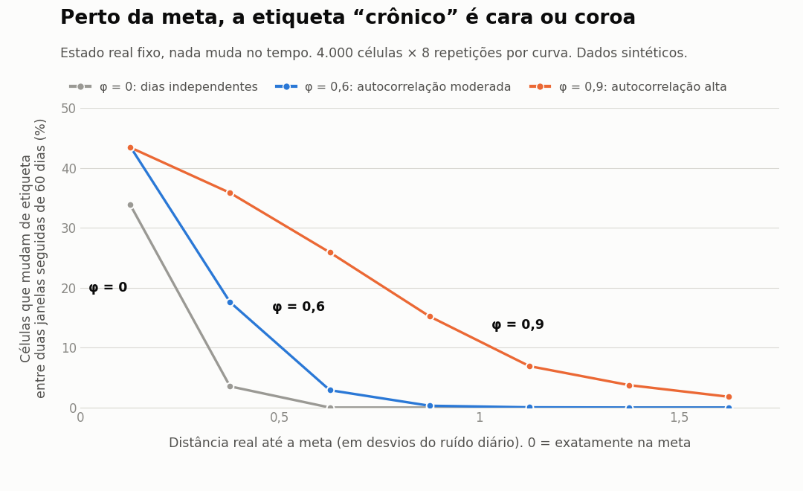

# A etiqueta "crônico" é estável? Perto da meta, é cara ou coroa

Experimento reproduzível, com **dados 100% sintéticos** e **verdade conhecida**, sobre classificar uma série como "crônica"
a partir da fração de dias abaixo de uma meta.



## A pergunta

Cada célula tem um estado real fixo: nível médio = meta + `m` (`m < 0`: está de fato abaixo da meta). O indicador diário é esse
nível mais ruído com autocorrelação (AR(1), desvio 2 p.p.). **Nada muda no tempo.**

A regra testada tem a forma usual de uma classificação de cronicidade, em janela de 60 dias:

```
crônico = (>= 50% dos dias abaixo da meta)  OU  (>= 14 dias abaixo da meta em sequência)
```

Se o estado real é o mesmo, duas janelas seguidas deveriam dar a mesma etiqueta. Quando não dão, a etiqueta está medindo o ruído.

## Resultado

**Em geral a regra funciona.** Com `m` sorteado entre -6 e +6 p.p. e autocorrelação moderada (φ = 0,6), ela troca de etiqueta em 5,4% dos
casos e erra o estado real em 3,8%. O problema está todo perto da meta (`m` em desvios do ruído diário):

| Distância até a meta | Troca de etiqueta entre janelas | Erra o estado real |
|---|---|---|
| a mais de 0,75 desvio (acima ou abaixo) | 0,0% a 0,2% | 0,0% a 0,1% |
| 0,25 a 0,75 abaixo da meta | 8,5% | 4,7% |
| 0 a 0,25 abaixo da meta | 40,9% | 29,4% |
| 0 a 0,25 acima da meta | 46,4% | 39,4% |
| 0,25 a 0,75 acima da meta | 11,9% | 6,5% |

(Tabela completa em `python cronico.py`; os números acima são do cenário φ = 0,6, 10 repetições.)

**A largura da faixa de dúvida depende da autocorrelação.** Faixa em que a etiqueta troca em mais de 10% dos casos, janela de 60 dias:

| Autocorrelação (φ) | Largura da faixa (desvios) | Em p.p., com desvio de 2 p.p. |
|---|---|---|
| 0 (dias independentes) | 0,3 | 0,6 |
| 0,6 | 0,5 | 1,0 |
| 0,9 | 0,9 | 1,8 |

Com autocorrelação, 60 dias valem menos que 60 observações independentes. A aproximação usual para AR(1) é
`n_efetivo ≈ n · (1 − φ) / (1 + φ)`: cerca de 15 dias com φ = 0,6 e cerca de 3 com φ = 0,9.

**Uma banda de indecisão ajuda, mas não resolve tudo.** Rotulando como "indeterminada" a célula com 35% a 65% dos dias fora:

| Cenário (janela de 60 dias) | Indeterminadas | Troca de etiqueta: binária | Troca entre as definidas |
|---|---|---|---|
| φ = 0,6 | 11,9% | 5,3% | 0,2% |
| φ = 0,9 | 11,0% | 9,8% | 3,0% |

## O que isso mostra, e o que não mostra

- A etiqueta binária é um corte em cima de uma medida contínua. Longe da meta funciona; perto dela, **nada na etiqueta diz que a célula está na zona de dúvida**.
- A parte "14 dias seguidos" **quase não muda nada** com φ ≤ 0,6 (38 etiquetas a mais em 24.000). Com φ = 0,9 ela acrescenta 3,3% de etiquetas,
  e só cerca de 31% dessas células são de fato crônicas neste cenário.
- Em dados reais, parte da troca de etiqueta é mudança real, não ruído. Aqui o estado é fixo de propósito, para isolar o efeito do ruído.
- Não medi a autocorrelação de nenhum dado real. O resultado depende de φ, e φ é o primeiro número a medir antes de escolher uma janela.
- A fração de células na zona de dúvida depende de como a carteira se distribui em torno da meta. Aqui é uniforme (−6 a +6 p.p.); a taxa "geral" (5,4%) muda com isso, as taxas por distância não.
- Ruído gaussiano, janela e limiares fixos (50% e 14 dias). Outras escolhas mudam os números, não o mecanismo.

## Como rodar

```bash
pip install -r requirements.txt
python cronico.py          # tabelas por distância até a meta; grava resultados.csv
python sensibilidade.py    # φ x janela x banda de indecisão; grava sensibilidade.csv
python grafico.py          # grava grafico_cronico.png e curva.csv
pytest -q                  # 4 testes das funções
```

Tudo é determinístico (sementes fixas).
